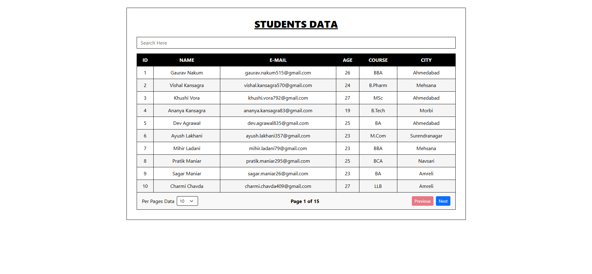
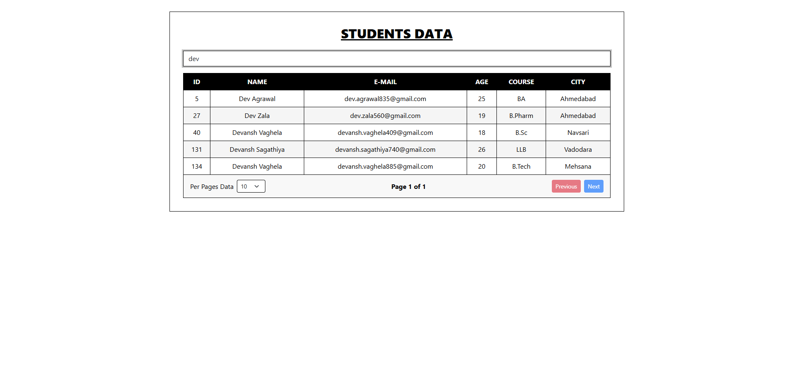

# Student Data Table

A responsive React component that displays 150 student records in a black-and-white table, with global search, column sorting and pagination. Data is served by a local `json-server` API, and browser `localStorage` is not used.

## Features

- **Data source:** records are fetched on mount from `http://localhost:5000/students` (json-server, backed by `db.json`).
- **Global search:** one input that filters across every column as you type, using `event.target.value`.
- **Column sorting:** click a header to sort ascending, click again for descending. The active column shows a ▲ or ▼ arrow.
- **Pagination:**
  - Left: "Per Pages Data" dropdown with 5, 10, 20, 30, 50, 100, 150, 200, 250 and 300 rows.
  - Center: current position, for example "Page 1 of 15".
  - Right: a red **Previous** button and a blue **Next** button, disabled at the first and last page.
- **Black and white theme** built with Bootstrap utility classes.

## Tech Stack

- React 18
- Vite
- Bootstrap 5
- json-server 0.17 (mock REST API)

## Project Structure

```
student-data-table/
├── db.json            # 150 student records served by json-server
├── index.html
├── package.json
├── vite.config.js
└── src/
    ├── main.jsx       # App entry, loads Bootstrap and global CSS
    ├── App.jsx        # Student table component
    └── index.css      # Black-and-white theme styles
```

## Getting Started

### Prerequisites

- Node.js 18 or newer (check with `node -v`)

### Install

```bash
npm install
```

### Run

```bash
npm start
```

This starts both servers at once:

| Service | URL |
| --- | --- |
| json-server API | http://localhost:5000/students |
| React app (Vite) | http://localhost:5173 |

To run them separately in two terminals:

```bash
npm run api   # json-server on port 5000
npm run dev   # Vite dev server
```

Press `Ctrl + C` in the terminal to stop.

## Available Scripts

| Command | Description |
| --- | --- |
| `npm start` | Runs the API and the dev server together |
| `npm run api` | Runs json-server on port 5000 |
| `npm run dev` | Runs the Vite dev server |
| `npm run build` | Creates a production build in `dist/` |
| `npm run preview` | Previews the production build |

## How the Table Works

All state lives in `App.jsx` using `useState`: `data`, `searchQuery`, `sortConfig`, `currentPage` and `rowsPerPage`.

On every render the data goes through this pipeline using native array methods, with no `useMemo`:

1. `.filter()` applies the search query across all columns.
2. `.sort()` orders the results based on `sortConfig`.
3. `.slice()` extracts the rows for the current page.
4. `.map()` renders the rows in the JSX.

Changing the search text, sort column or rows per page resets the table to page 1.

## Data Format

Each record in `db.json` looks like this:

```json
{
  "id": 1,
  "name": "Dhaval Rangapara",
  "email": "dhavalrangapara012@gmail.com",
  "age": 20,
  "course": "BBA",
  "city": "Morbi"
}
```

## Output

### Table View


### Search / Pagination View


## Troubleshooting

- **Table shows "Could not load students":** json-server isn't running. Use `npm start`, or run `npm run api` in a second terminal.
- **Port already in use:** close the other app using port 5000 or 5173, or change the port in the `api` script in `package.json` and in `API_URL` in `src/App.jsx`.